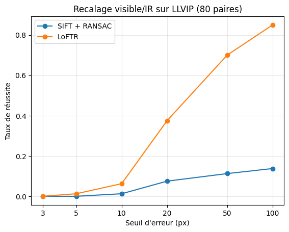
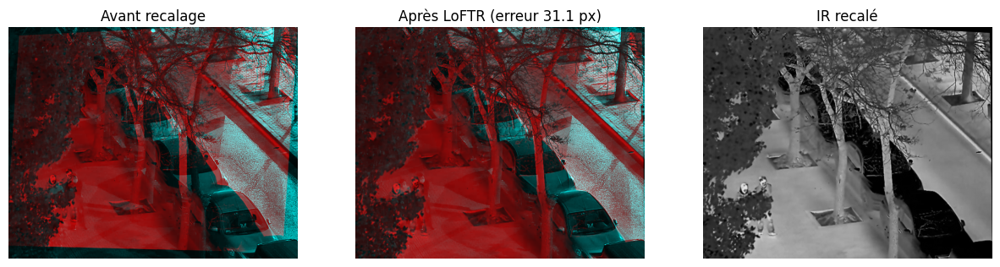

# Recalage multimodal visible / infrarouge : SIFT vs LoFTR

Mini-projet exploratoire comparant une méthode classique (SIFT + RANSAC) et une méthode
deep learning (LoFTR pré-entraîné, via kornia) pour le recalage d'images visible / infrarouge.

## Protocole
- **Données** : 80 paires du jeu LLVIP (images terrestres de nuit), utilisées comme proxy
  du visible/IR satellitaire. Usage non commercial, voir le dépôt LLVIP.
- Une homographie aléatoire connue est appliquée à l'image IR ; chaque méthode doit la retrouver.
- **Erreur** : distance moyenne en pixels sur les 4 coins (images 1280x1024).
- **Vérification** : visible -> visible donne 100 % de réussite (< 3 px) pour les deux méthodes.

## Résultats
| Seuil d'erreur | SIFT + RANSAC | LoFTR |
|----------------|---------------|-------|
| < 20 px | 7 % | 38 % |
| < 50 px | 11 % | 70 % |

Erreur médiane : environ 870 px (SIFT) contre environ 27 px (LoFTR).

Exemple : paire médiane (erreur 31 px). Rouge = IR, cyan = visible.

## Limites
- Images terrestres, pas satellitaires ; déformation synthétique ; une seule graine aléatoire.
- Les paires LLVIP ne sont pas parfaitement alignées au pixel.
- LoFTR utilisé sans fine-tuning ; la précision subpixel n'est pas atteinte.
- Pistes : affinement subpixel, fine-tuning multimodal, test sur des images Sentinel-2.

## Utilisation
Ouvrir `recalage_visible_ir.ipynb` dans Google Colab (GPU recommandé) et fournir un
échantillon de paires LLVIP dans `data/visible` et `data/infrared`.

## Données
LLVIP : https://github.com/bupt-ai-cz/LLVIP
